# StreamVerse: OTT Streaming Analytics (SQL + Power BI)

> **Educational project using simulated data. Not affiliated with or endorsed by any streaming company.**
> StreamVerse is a fictional brand.

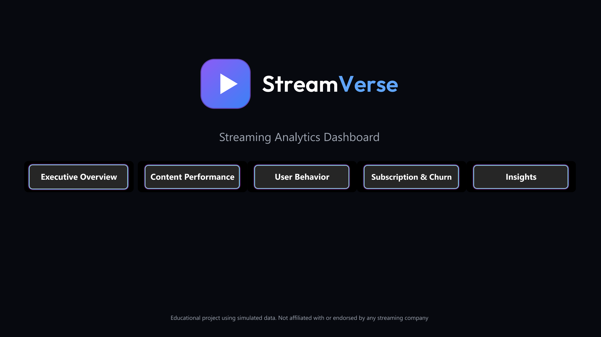

An end-to-end analytics project for a fictional streaming platform: synthetic data generation in Python, cleaning and analysis in MySQL, and a six-page interactive Power BI dashboard with drill-through, tooltips, and synced slicers.

**The business questions:**
- Which titles, genres, and languages get the most watch time?
- When do people watch, and on which devices?
- Where does churn happen, and which subscribers stay?
- Which highly rated titles are being missed?

---

## Tools

| Stage | Tool |
|---|---|
| Data generation | Python (pandas, numpy) |
| Database and analysis | MySQL, DBeaver |
| Dashboard | Power BI Desktop (DAX, Power Query, custom theme) |

## Dataset (simulated)

| Table | Type | Rows |
|---|---|---|
| `dim_users` | dimension | 5,000 users (5,060 raw, with 60 duplicates) |
| `dim_content` | dimension | 300 titles |
| `dim_genre`, `dim_plan`, `dim_device`, `dim_date` | dimensions | 12, 3, 4, 731 |
| `fact_watch_history` | fact | 100,000 sessions (100,400 raw) |
| `fact_subscriptions` | fact | 5,000 |
| `fact_ratings` | fact | about 6,200 |

Two years of data (Jan 2023 to Dec 2024). The generator builds in realistic patterns (evening and weekend peaks, regional language preferences, a month-1 churn spike, a few blockbusters) and about 3 to 5% **dirty data** (mixed-case and padded city names, null ages, genders, and minutes, duplicate rows) so the cleaning step is real.

## Pipeline

```
Python generator -> 9 CSVs -> MySQL staging (stg_*) -> SQL cleaning -> star schema (dim_*, fact_*) -> SQL views -> Power BI
```

1. **Staging layer:** raw CSVs load as text into `stg_*` tables, so nothing is lost or rejected.
2. **Cleaning:** duplicates removed with `ROW_NUMBER()`; city names standardised with `TRIM`/`UPPER`/`LOWER`; ages like `30.0` cast to integers; blanks converted to `NULL`; missing minutes filled with the title average.
3. **Star schema:** six dimension tables and three fact tables, with primary and foreign keys.
4. **Views for Power BI:** derived columns (age bands, churn flags, tenure, time-of-day buckets, hidden-gem flag, monthly revenue).

## SQL highlights

24 business questions answered in [`sql/04_analysis_queries.sql`](sql/04_analysis_queries.sql), including:

- **Window functions:** top 3 titles per language (`ROW_NUMBER`/`DENSE_RANK` with `PARTITION BY`), running revenue totals (`SUM() OVER`), month-over-month growth (`LAG`), share-of-total percentages.
- **CTEs:** layered queries for device share by plan, monthly revenue with active-subscriber logic, and 3-month cohort retention.
- **Segmentation:** age bands with `CASE`, quartile analysis with `NTILE` to find "hidden gem" titles, top-decile power users.
- **Churn analysis:** churn by plan, exits within 30 days, subscription tenure distribution.

```sql
-- Top 3 titles per language, with each title's share of that language's watch time
WITH cte1 AS (
    SELECT c.content_id, c.title, c.language,
           SUM(minutes_watched / 60) AS total_hrs
    FROM fact_watch_history wh
    JOIN dim_content c ON wh.content_id = c.content_id
    GROUP BY c.content_id, c.title, c.language
),
cte2 AS (
    SELECT *,
           ROUND(total_hrs * 100.0 / SUM(total_hrs) OVER (PARTITION BY language), 2) AS lang_share,
           DENSE_RANK() OVER (PARTITION BY language ORDER BY total_hrs DESC) AS rnk
    FROM cte1
)
SELECT * FROM cte2 WHERE rnk <= 3 ORDER BY language, rnk;
```

## Dashboard

Six pages with a shared header, a plan filter synced across pages, and a custom dark theme. Page navigation uses buttons; a hidden drill-through page and a tooltip page extend the content views.

### Executive Overview
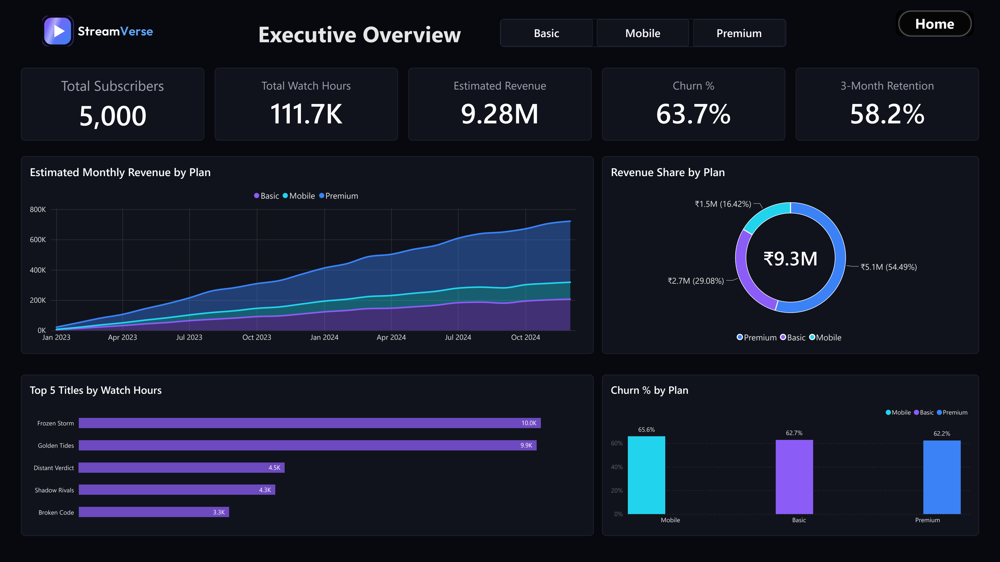

### Content Performance
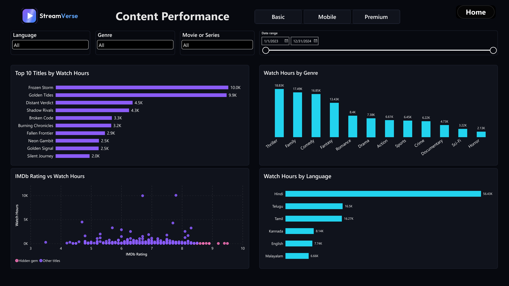

### User Behavior
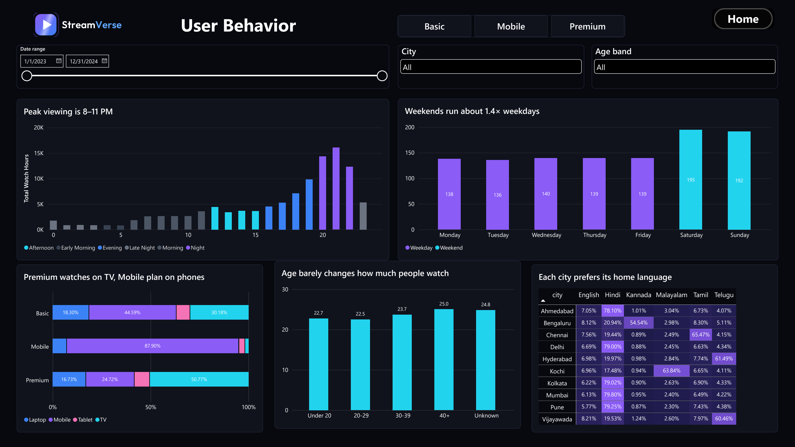

### Subscription & Churn
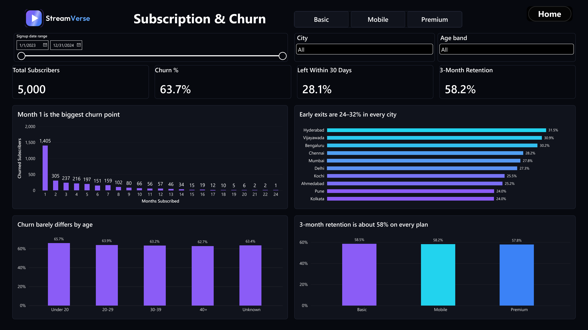

### Insights
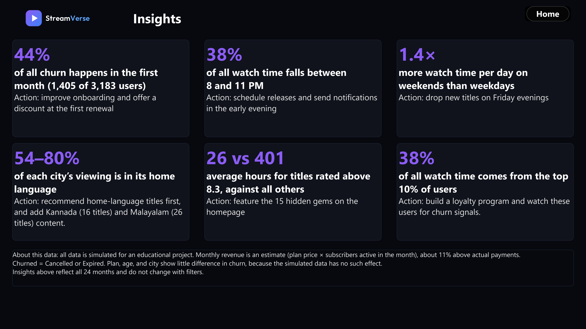

### Interactivity
- **Slicers:** plan (synced across pages), language, genre, type, city, age band, and date ranges. Watch dates are synced between Content Performance and User Behavior; the signup-date slider on Subscription & Churn is independent.
- **Drill-through:** right-click a title in the Top 10 chart or the scatter plot to open a single-title page.
- **Tooltip page:** hover over a dot in the rating-vs-watch-hours scatter plot for title details.
- **Conditional formatting:** heatmap of language share by city.

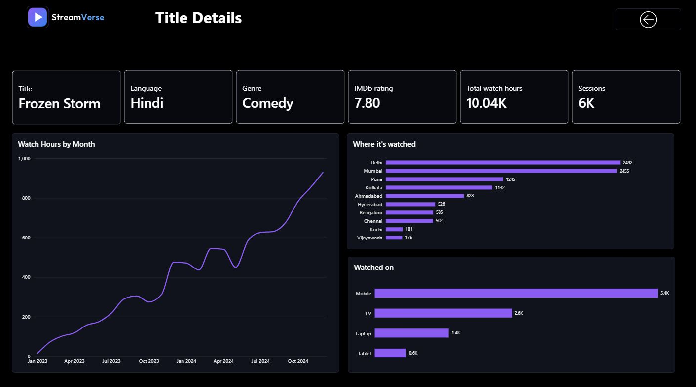
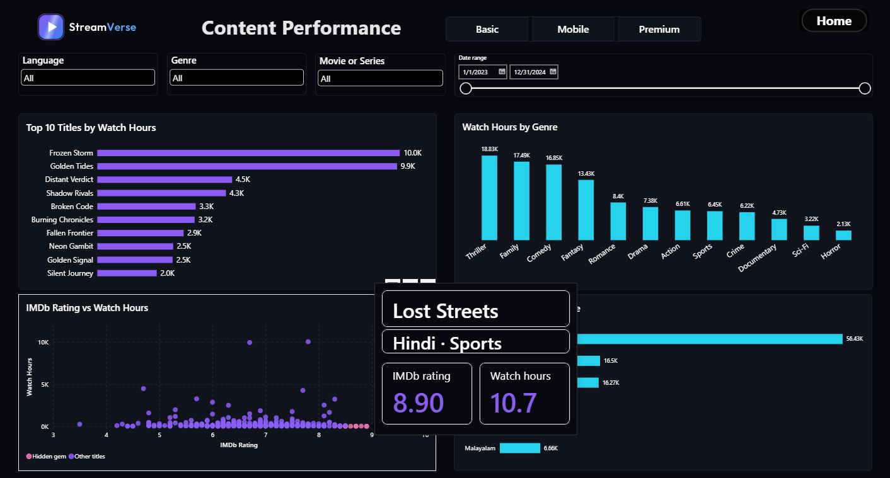
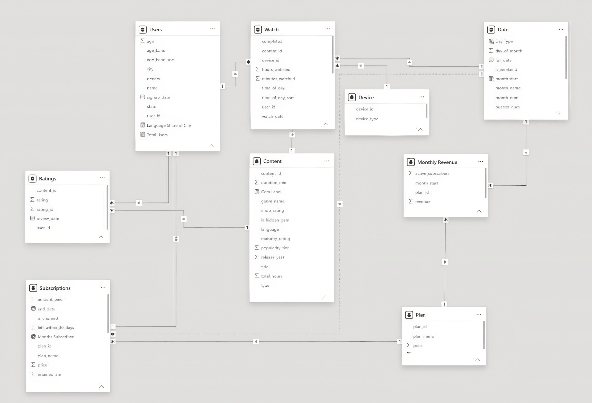

*Demo of the interactions:*
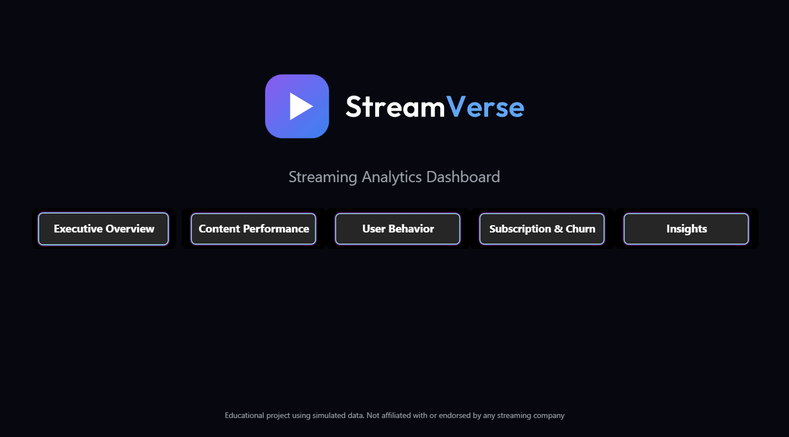

### Data model
Star schema with the date table marked as the date dimension. The subscription facts connect to the date table through an **inactive relationship** (activated in DAX with `USERELATIONSHIP`), so subscription measures follow **signup date** and watch measures follow **viewing date**.

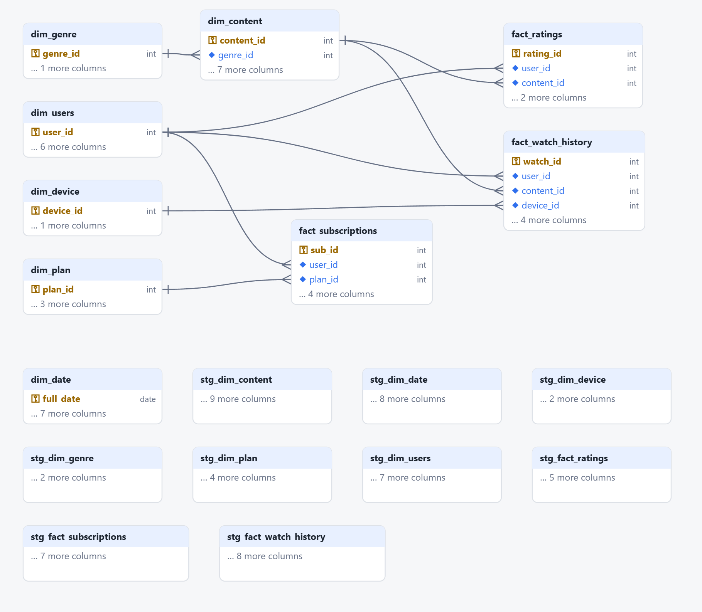
dim_date is a calendar table joined by date in Power BI (no SQL foreign key)
ER diagram exported from a custom SQL client I built "Rusa db studio"

### Selected DAX measures
```
Total Watch Hours = SUM(Watch[hours_watched])
Churn % = DIVIDE([Churned Subscribers], [Total Subscribers])
Total Subscribers = CALCULATE(COUNTROWS(Subscriptions),
                              USERELATIONSHIP('Date'[full_date], Subscriptions[start_date]))
Avg Hours per Day = DIVIDE([Total Watch Hours], DISTINCTCOUNT(Watch[watch_date]))
Device Share % = DIVIDE([Total Watch Hours],
                        CALCULATE([Total Watch Hours], ALL('Device'[device_type])))
```

## Key findings and recommendations

Each finding is tagged: **Supported** (shown by the data) or **Hypothesis** (needs more data).

| Finding | Recommended action | Confidence |
|---|---|---|
| 63.7% of subscribers churned, and **44% of all churn happens in the first month** (1,405 of 3,183). The median churner stays 2 months. | Improve onboarding; offer a discount at the first renewal. | Supported |
| **38%** of all watch time falls between **8 and 11 PM**; weekends run about **1.4×** weekday watch time per day. | Schedule releases and notifications for evenings and Friday nights. | Supported |
| Each city's home language takes **54% to 80%** of its viewing. Kannada (16 titles) and Malayalam (26 titles) have the thinnest catalogs. | Recommend home-language titles first; add Kannada and Malayalam content. | Supported |
| **15 hidden gems** (rated above 8.3, bottom 25% of watch time). Titles rated above 8.3 average 26 hours against 401 for the rest. | Feature them on the homepage and in recommendations. | Supported |
| The top 10% of users generate **38%** of watch time. | Loyalty program; monitor these users for churn signals. | Supported |
| Premium users watch **51% on TV**; the Mobile plan is **88% on phones**. | Tailor product features to each plan's device. | Supported |
| Plan, age, and city show almost no difference in churn or retention (about 58% 3-month retention everywhere). | Look at other drivers: content, price, onboarding. | Supported |
| Under-20 users are fewer, but the band covers only ages 16 to 19; hours per user are similar across age bands. | Test a student offer before rolling it out. | Hypothesis |
| Month-over-month revenue growth fell from 140% to about 2%. | Early percentages reflect a tiny base; compare sign-ups against churn each month. | Supported |

## Assumptions and limitations

- **All data is simulated.** Patterns come from the generator's rules, so the results demonstrate method, not real-world behaviour.
- **Monthly revenue is an estimate:** plan price × subscribers active at any point in the month. It totals about ₹9.28M, roughly 11% above actual `amount_paid` (₹8.33M), because a subscription touching two calendar months is counted in both.
- Billing periods are 30 days; subscription length is days ÷ 30.
- **Churned** = status Cancelled or Expired. **Retained at 3 months** = still subscribed three months after signup, counting only cohorts old enough to have reached that mark.
- Missing ages stay `NULL` (shown as "Unknown"); missing watch minutes use the title's average; Kolkata is assigned Hindi as its home language because the catalog has no Bengali content.
- Insight tiles on the Insights page are static text taken from the SQL results.

## Repository structure

```
streamverse-ott-analytics/
├── README.md
├── data/raw/                    # 9 generated CSVs (includes intentionally dirty data)
├── python/generate_data.py      # synthetic data generator
├── sql/
│   ├── 01_create_tables.sql     # database, staging and star-schema tables
│   ├── 02_load_data.sql         # CSV loading into staging
│   ├── 03_data_cleaning.sql     # profiling, cleaning, validation
│   ├── 04_analysis_queries.sql  # 24 business questions
│   └── 05_views_for_powerbi.sql # derived views for the dashboard
├── powerbi/
│   ├── StreamVerse.pbix
│   └── StreamVerse_theme_v2.json
├── screenshots/                 # dashboard pages
├── assets/                      # logo and demo GIF
└── docs/erd_diagram.png
```

## How to reproduce

1. `pip install pandas numpy`, then `python python/generate_data.py` (writes CSVs to `data/raw/`).
   *The committed CSVs were generated in an earlier run. Re-running the script gives the same numeric patterns but different title names, because titles come from an unordered set.*
2. In MySQL, run `sql/01_create_tables.sql`.
3. Load the CSVs into the `stg_*` tables (`02_load_data.sql` uses `LOAD DATA LOCAL INFILE`; edit the folder path and enable `local_infile`, or use your client's CSV import wizard).
4. Run `sql/03_data_cleaning.sql`, then `sql/05_views_for_powerbi.sql`.
5. Open `powerbi/StreamVerse.pbix` and point the MySQL connection at your `streamverse` database.

## About

Built as a learning portfolio project. Feedback is welcome.

**Author:** Sai Kiran Bathini · [LinkedIn](https://www.linkedin.com/in/saikiran-bathini)
